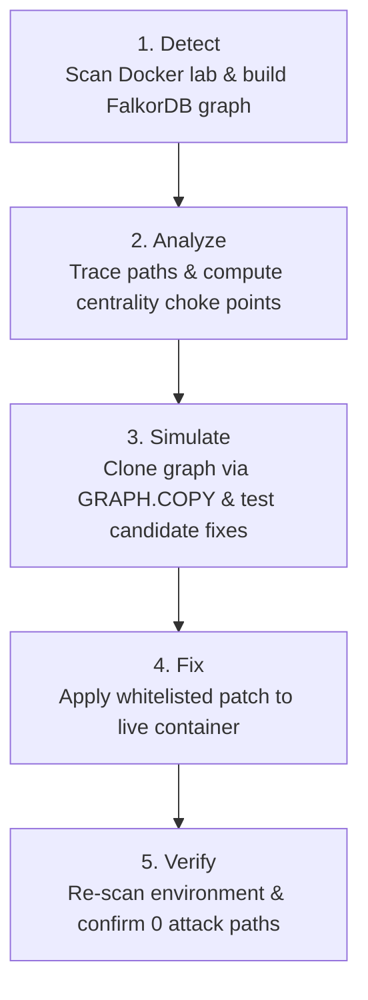

# Giving an AI agent a graph: closing attack paths with FalkorDB

## The Problem: Alert Lists Don't Show How Attacks Connect

Traditional security scanners output long lists of disconnected CVEs. A scan might report 100 vulnerabilities across enterprise servers. For a security team, patching every single CVE is impossible due to limited engineering bandwidth and the risk of breaking production.

Crucially, isolated CVE lists miss how attackers actually move. Threat actors don't care about isolated bugs; they look for connected chains of weaknesses that let them cross network boundaries—from a public server, through internal gateways, to crown jewel databases holding customer records.

Without a connected view of network topology, teams either guess what to patch first or waste effort fixing low-risk vulnerabilities that cannot lead to sensitive assets.

---

## The Graph Model

Graphs are the natural data structure for infrastructure security. Instead of treating containers as separate rows in a table, we model the environment as a connected property graph:

- **Nodes**: Services (`web`, `api`, `admin`, `db`, `fileshare`), vulnerabilities (`Vuln`), crown jewel data (`CrownJewel`), and external threat actors (`Attacker`).
- **Relationships**: Network reachability (`CAN_REACH`), vulnerability exposure (`HAS_VULN`), data ownership (`HOLDS`), and traversable exploit links (`EXPLOITABLE_FROM`).

An edge of type `EXPLOITABLE_FROM` is formed only when two conditions are met: the source service shares a network segment with the target service, and the target service has an unpatched, exploitable vulnerability on an open port.

---

## The Closed Loop: Detect, Simulate, Fix, Verify

Rather than just answering questions, our defensive AI agent operates in a closed loop:



1. **Detect**: The scanner inspects container networks and queries service configurations, populating the `lab` graph in FalkorDB.
2. **Analyze**: The agent runs Cypher traversals to discover all active paths reaching crown jewels and computes graph centrality to pinpoint the top choke point.
3. **Simulate**: Before touching the live environment, the agent tests fixes in an isolated graph copy.
4. **Fix**: The agent applies the best fix to the live container using a strict whitelist.
5. **Verify**: The agent re-scans the lab and queries FalkorDB to confirm that the attack paths are gone.

---

## Why FalkorDB

FalkorDB is uniquely suited for this task for three reasons:

1. **Expressive Cypher Traversals**: Finding arbitrary-length multi-hop paths takes a single query:
```cypher
MATCH p = (a:Attacker)-[:EXPLOITABLE_FROM*1..5]->(s:Service)-[:HOLDS]->(cj:CrownJewel)
RETURN [n IN nodes(p) WHERE NOT n:CrownJewel | n.name] AS path
```
2. **Instant Sandbox Simulation via `GRAPH.COPY`**: The agent clones the graph into `lab_sim` in milliseconds (`GRAPH.COPY lab lab_sim`), mutates the copy, tests whether paths drop to zero, and deletes the clone. Production is never put at risk.
3. **Graph Centrality Algorithms**: Computing betweenness centrality and path intersections reveals that `api` sits on 100% of attack paths, making it the highest-leverage remediation target.

---

## Results: 3 Paths to 0

In our Docker lab, three initial attack paths reached crown jewels (`db` and `fileshare`):
- `Attacker -> web -> api -> db`
- `Attacker -> web -> api -> admin -> db`
- `Attacker -> web -> api -> fileshare`

Simulating fixes on `api` proved that patching CVE-2023-22515 severs all three attack paths in one action. After applying the patch, a re-scan confirmed that attack paths dropped from **3 to 0**.

---

## Safety Design

Autonomous security agents must be safe by design. In our system:
- All vulnerabilities are simulated via metadata configurations; no real exploits are executed.
- The lab runs locally on private Docker bridge networks.
- The agent cannot run arbitrary shell commands. It is restricted to three whitelisted actions (`patch_service`, `rotate_credential`, `disconnect_network`) on five approved lab services.

---

## What's Next

We plan to expand the agent to ingest real-world cloud security configurations (AWS IAM, Kubernetes RBAC, and VPC peering topologies), enabling automated choke-point identification and remediation across multi-cloud environments.
