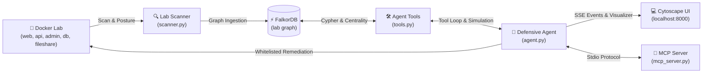

# 🛡️ Closed-Loop Attack-Path Agent (Graph Hacks, Track 1)

> **Autonomous defensive cybersecurity agent using FalkorDB to discover, simulate, and eliminate multi-hop Docker attack paths in connected environments.**

[](https://falkordb.com)
[](LICENSE)
[](https://python.org)
[](https://fastapi.tiangolo.com)
[](https://falkordb.com)

---

## 📌 Hackathon Compliance & Integrity Notice
> **All FalkorDB code was written during Oct 15-18, 2026 for Graph Hacks.** All graph modeling, Cypher algorithms, Docker lab configurations, MCP tools, and autonomous agent loops were developed exclusively within the hackathon window.

---

## 🎯 Executive Summary & Problem Statement

Modern enterprise networks consist of complex multi-cloud and segmented container topologies. When vulnerabilities and weak credentials exist across internal nodes, attackers don't simply attack one machine—they traverse **multi-hop attack paths** across security boundaries to reach crown jewel databases.

Traditional point scanners report hundreds of isolated CVEs without understanding network context. Remediating every CVE is impossible. Security teams need to identify the **exact architectural choke point** where a single targeted fix severs every attack path simultaneously.

The **Closed-Loop Attack-Path Agent** solves this:
1. **Detect**: Uses Docker SDK to map network segmentation and ingest service vulnerability postures into **FalkorDB**.
2. **Decide**: Traverses multi-hop paths to crown jewels, computes PageRank and Betweenness Centrality in FalkorDB, and identifies the #1 choke point (`api`).
3. **Simulate**: Clones the graph via `GRAPH.COPY` to test candidate fixes in an isolated sandbox (`lab_sim`) without touching production.
4. **Act**: Enforces a strict defensive whitelist (`patch_service`, `rotate_credential`, `disconnect_network`) to apply the optimal remediation to the live Docker lab.
5. **Verify**: Re-scans the environment, executes Cypher path verification, and verified by re-scan: attack paths dropped from **3 to 0**.

---

## 🏛️ System Architecture



---

## 🗺️ Track 1 Feature Mapping

| Track 1 Requirement | Where Implemented | Technical Description |
| :--- | :--- | :--- |
| **Multi-Hop Reasoning** | [`app/graph.py`](file:///d:/Projects/Closed_loop_attack_path-agent/app/graph.py#L220-L260)<br/>[`app/tools.py`](file:///d:/Projects/Closed_loop_attack_path-agent/app/tools.py#L90-L115) | Cypher traversals trace dynamic length paths `(:Attacker)-[:EXPLOITABLE_FROM*1..5]->(:Service)-[:HOLDS]->(:CrownJewel)` across network boundaries. |
| **Graph Algorithms as Tools** | [`app/graph.py`](file:///d:/Projects/Closed_loop_attack_path-agent/app/graph.py#L280-L340)<br/>[`app/tools.py`](file:///d:/Projects/Closed_loop_attack_path-agent/app/tools.py#L120-L150) | Betweenness centrality, PageRank, and path intersection frequencies are exposed directly as callable agent tools (`find_choke_points`). |
| **Safe Graph Simulation** | [`app/graph.py`](file:///d:/Projects/Closed_loop_attack_path-agent/app/graph.py#L350-L410)<br/>[`app/tools.py`](file:///d:/Projects/Closed_loop_attack_path-agent/app/tools.py#L155-L185) | Executes `GRAPH.COPY lab lab_sim` to simulate mutations and quantify path reduction prior to touching the live environment. |
| **MCP Tool Selection** | [`app/mcp_server.py`](file:///d:/Projects/Closed_loop_attack_path-agent/app/mcp_server.py#L30-L99) | Exposes all 7 tools to external LLM clients (Claude Desktop, Cursor, Claude Code) using the Model Context Protocol standard. |
| **Explainable Results** | [`app/graph.py`](file:///d:/Projects/Closed_loop_attack_path-agent/app/graph.py#L420-L470)<br/>[`app/agent.py`](file:///d:/Projects/Closed_loop_attack_path-agent/app/agent.py#L305-L345) | Generates hop-by-hop CVE evidence chains and a full comparative audit report contrasting simulated candidate remediations. |

---

## ⚡ FalkorDB Graph Schema

### Node Labels
- `(:Attacker)`: External threat actor entry point.
- `(:Service {name, zone, version, creds_weak})`: Lab microservices (`web`, `api`, `admin`, `db`, `fileshare`).
- `(:Vuln {cve, name, severity, exploitable})`: CISA KEV simulated vulnerabilities.
- `(:CrownJewel {name})`: Protected organizational data assets (`customer_data`, `customer_backups`).
- `(:Identity {name, role})`: Administrative credentials and service accounts.

### Relationship Types
- `(:Attacker)-[:CAN_REACH {via: "internet"}]->(:Service)`
- `(:Service)-[:CAN_REACH {via: network_name}]->(:Service)`
- `(:Service)-[:HAS_VULN]->(:Vuln)`
- `(:Service)-[:HOLDS]->(:CrownJewel)`
- `(:Identity)-[:HAS_ACCESS_TO]->(:Service)`
- `(:Service)-[:EXPLOITABLE_FROM]->(:Service)`: Formed when service A shares a network with service B, B exposes an active port, and B has an exploitable CVE or weak credentials.

---

## 🔍 How FalkorDB Drives Each Decision

Every action taken by the AI agent is governed directly by FalkorDB graph algorithms and Cypher queries:

### 1. Multi-Hop Attack Path Traversal
Discovers all paths from the attacker through intermediate exploited nodes to crown jewel assets:
```cypher
MATCH p = (a:Attacker)-[:EXPLOITABLE_FROM*1..5]->(s:Service)-[:HOLDS]->(cj:CrownJewel)
RETURN [n IN nodes(p) WHERE NOT n:CrownJewel | n.name] AS path
```
*Result*: Returns the 3 active attack paths:
- `Attacker -> web -> api -> db`
- `Attacker -> web -> api -> admin -> db`
- `Attacker -> web -> api -> fileshare`

### 2. Graph Centrality & Choke Point Discovery
Quantifies service intersection frequency across attack paths and calculates graph centrality (Betweenness Centrality and PageRank):
```cypher
MATCH p = (a:Attacker)-[:EXPLOITABLE_FROM*1..5]->(s:Service)-[:HOLDS]->(cj:CrownJewel)
UNWIND [n IN nodes(p) WHERE n:Service | n.name] AS svc
RETURN svc, count(DISTINCT p) AS path_count
ORDER BY path_count DESC
```
*Result*: Identifies `api` as the #1 choke point, intersecting **100% of attack paths** with highest betweenness centrality across the DMZ-to-Internal boundary.

### 3. Safe Graph Simulation via `GRAPH.COPY`
Before making any real modification, the agent creates an isolated copy of the graph:
```redis
GRAPH.COPY lab lab_sim
```
In `lab_sim`, it simulates candidate fixes:
```cypher
MATCH (s:Service {name: $service})-[:HAS_VULN]->(v:Vuln)
SET v.exploitable = false
WITH s
MATCH ()-[r:EXPLOITABLE_FROM]->(s)
DELETE r
```
It then queries `attack_paths("lab_sim")`, verifying that paths drop to **0**. It cleans up with `GRAPH.DELETE lab_sim`. **The live graph `lab` is completely untouched during simulation.**

### 4. Hop-by-Hop Explainability
Every path is decomposed into its exact CVE identifiers, CVSS severities, and network transit mechanisms, providing full explainability for security auditors.

---

## 🧠 How the Agent Decides

The agent operates under a strict closed-loop defensive policy:
- **Default Mode**: The **Claude tool-use loop** (via Anthropic API with `claude-sonnet-5-5`) is the primary driver when `ANTHROPIC_API_KEY` is present.
- **Deterministic Fallback**: The **autonomous graph policy** runs automatically whenever no API key is configured or if an external API call fails. It follows the exact same tool pipeline:
  1. `scan_lab`
  2. `find_attack_paths`
  3. `find_choke_points`
  4. `simulate_fix` on the top 3 candidate remediations
  5. Selects the fix yielding the lowest remaining paths (preferring least disruptive on ties)
  6. `apply_fix` on live lab
  7. `rescan_and_verify`
- **Audit Transparency**: Every run states clearly in the final report output which execution mode ran (e.g., `Claude Sonnet Tool-Use Loop` or `Deterministic Fallback (No ANTHROPIC_API_KEY configured)`).

---

## 🔒 Defensive Safety Design

- **100% Simulated Vulnerabilities**: Vulnerabilities are simulated from config files; no real exploits or weaponized payloads are executed.
- **Local Isolation**: The lab environment runs strictly locally on private Docker bridges (`dmz_net`, `internal_net`).
- **Strict Whitelist Validation**: `apply_fix` is strictly limited to three whitelisted actions on known lab services:
  - `patch_service` (updates config JSON, bumps semantic version, clears exploitable flag).
  - `rotate_credential` (resets weak credentials flag).
  - `disconnect_network` (detaches container from specific network bridge).
- **Approved Inventory Only**: Only the 5 approved services (`web`, `api`, `admin`, `db`, `fileshare`) can be targeted. Arbitrary shell execution or external network calls are impossible.

---

## 🚀 Quickstart & Setup

### Prerequisites
- Python 3.11 or 3.12
- (Optional) Docker & Docker Compose
- (Optional) Anthropic API key (fallback runs automatically if absent)

### Option A: Standalone Local Run (No Docker Required)

1. **Clone repository**:
   ```bash
   git clone https://github.com/<user>/closed-loop-attack-path-agent.git
   cd closed-loop-attack-path-agent
   ```

2. **Install dependencies**:
   ```bash
   pip install -r app/requirements.txt
   ```

3. **Configure Environment** (Optional):
   ```bash
   # Linux/macOS
   cp .env.example .env

   # Windows PowerShell
   Copy-Item .env.example .env
   ```

4. **Launch the Application**:
   ```bash
   uvicorn app.main:app --host 0.0.0.0 --port 8000 --reload
   ```

5. **Open Dashboard**:
   Navigate to `http://localhost:8000` in your browser.

---

### Option B: Docker Compose Launch

Launch the unified FalkorDB instance, the 5 segmented microservices, and the FastAPI agent:
```bash
docker compose up -d --build
```
Access the dashboard at `http://localhost:8000`.

---

## 🔌 Model Context Protocol (MCP) Usage

The agent exposes its 7 tools over the standard **Model Context Protocol (FastMCP / MCPServer)** in `app/mcp_server.py`, enabling external AI tools (Claude Desktop, Cursor, Claude Code) to analyze and remediate the network topology.

### Starting the MCP Server Directly
```bash
python -m app.mcp_server
```

### Claude Desktop Configuration (`claude_desktop_config.json`)
```json
{
  "mcpServers": {
    "attack-path-agent": {
      "command": "python",
      "args": ["-m", "app.mcp_server"],
      "cwd": "/path/to/closed-loop-attack-path-agent",
      "env": {
        "FALKORDB_HOST": "localhost",
        "FALKORDB_PORT": "6379"
      }
    }
  }
}
```

### Exposed MCP Tools
1. `scan_lab()`: Scans lab networks and builds FalkorDB graph.
2. `find_attack_paths()`: Discovers multi-hop exploit paths.
3. `find_choke_points()`: Ranks services by path intersection frequency and centrality.
4. `simulate_fix(service, fix)`: Tests fix in copied graph (`lab_sim`).
5. `apply_fix(service, fix)`: Applies whitelisted remediation to container.
6. `rescan_and_verify()`: Re-scans and verified by re-scan: attack paths dropped from 3 to 0.
7. `explain_path(path_id)`: Explains why a specific attack path succeeds.

---

## 🧪 Testing & Verification

Run the full pytest suite:
```bash
python -m pytest -v
```

All 12 acceptance criteria tests pass in **< 3 seconds**:
```
tests/test_acceptance.py::test_baseline_paths_and_choke_point PASSED     [  8%]
tests/test_acceptance.py::test_simulate_fix_preserves_real_graph PASSED  [ 16%]
tests/test_acceptance.py::test_whitelist_security_validation PASSED      [ 25%]
tests/test_acceptance.py::test_full_agent_run_eliminates_paths PASSED    [ 33%]
tests/test_acceptance.py::test_lab_reset_repeatability PASSED            [ 41%]
tests/test_api.py::test_health_endpoint PASSED                           [ 50%]
tests/test_api.py::test_graph_endpoint PASSED                            [ 58%]
tests/test_api.py::test_reset_endpoint PASSED                            [ 66%]
tests/test_api.py::test_run_endpoint PASSED                              [ 75%]
tests/test_tools.py::test_all_tools_standard_output_format PASSED        [ 83%]
tests/test_tools.py::test_explain_path_details PASSED                    [ 91%]
tests/test_tools.py::test_apply_and_verify_cycle PASSED                  [100%]
```

---

## 📂 Repository Structure

```
closed-loop-attack-path-agent/
├── docker-compose.yml          # Unified FalkorDB + Lab + Agent App
├── .env.example                # Sample environment variables
├── .gitignore                  # Git hygiene rules
├── LICENSE                     # MIT License
├── README.md                   # Complete architectural guide
├── DEMO.md                     # 3-minute video presentation script & backup plan
├── BLOG.md                     # Plain-language technical writeup
├── SUBMISSION.md               # Hackathon submission pack
├── scripts/
│   ├── demo_reset.ps1          # One-click Windows PowerShell demo reset
│   └── demo_reset.sh           # One-click Linux/macOS demo reset
├── lab/
│   ├── docker-compose.lab.yml  # Isolated 3-network lab definitions
│   ├── service/                # Lightweight Flask posture reporter
│   │   ├── app.py
│   │   ├── Dockerfile
│   │   └── requirements.txt
│   ├── config/                 # Active service configs mounted into containers
│   └── config_templates/       # Clean baseline configurations for instant reset
├── app/
│   ├── main.py                 # FastAPI backend + SSE endpoints
│   ├── graph.py                # FalkorDB client, Cypher queries & GRAPH.COPY
│   ├── scanner.py              # Docker network mapping & reachability builder
│   ├── fixes.py                # Strict whitelist enforcement & patch execution
│   ├── tools.py                # 7 tools + JSON schemas
│   ├── agent.py                # Claude tool loop & autonomous orchestrator
│   ├── mcp_server.py           # FastMCP server wrapping the 7 tools
│   ├── data/
│   │   └── kev_sample.json     # CISA KEV vulnerability snapshot
│   └── static/
│       └── index.html          # Sleek Cytoscape.js dark-mode UI
└── tests/
    ├── test_acceptance.py      # Core acceptance tests
    ├── test_tools.py           # Tool unit tests
    └── test_api.py             # FastAPI integration tests
```
